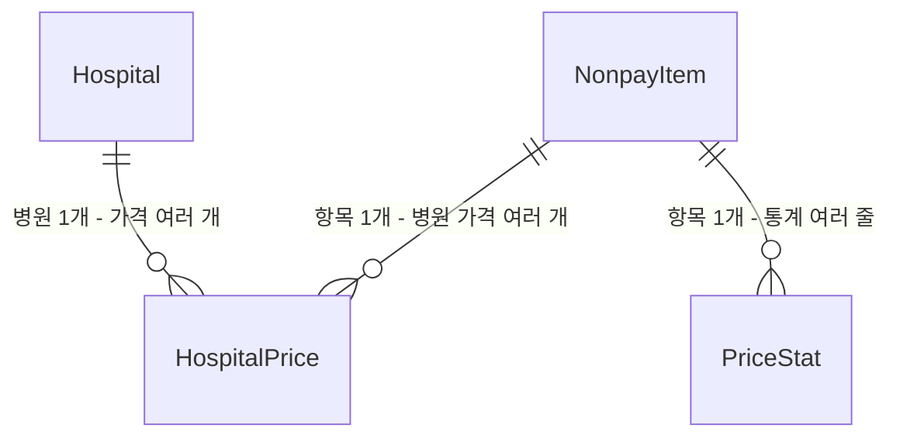

# 비급여 진료비 Q&A

건강보험심사평가원(심평원)이 공개하는 비급여 진료비 데이터로 질문에 답하는 Q&A 서비스입니다.
개인 포트폴리오 프로젝트입니다.

## 원칙
- **가격 숫자는 LLM이 만들지 않습니다.** DB에 저장된 값을 그대로 보여 주고, LLM은 설명 문장만 씁니다.
- 모든 답변에 출처, 기준일(적용개시일자), "병원급 이상 기준", "AI가 생성한 답변"을 붙입니다.
- 근거가 없으면 추정하지 않고 "데이터에 없음"으로 답합니다.
- 진단이나 치료를 권하는 질문에는 답하지 않습니다.
- 병원 추천, 순위, "최저가" 표시, 예약 연결 기능은 만들지 않습니다.

## 데이터 출처
- 공공데이터포털: 건강보험심사평가원_비급여진료비정보조회서비스 (공공누리 제1유형: 출처 표시)
- 의료법에 따라 **병원급 이상** 의료기관의 비급여 진료비만 들어 있습니다.
- API 요약: [docs/작업기록/api-guide.md](docs/작업기록/api-guide.md)

## 스택
| 영역 | 기술 |
|---|---|
| 백엔드 | Django, Django REST Framework |
| DB | PostgreSQL 16 + pgvector |
| 비동기 수집 | Celery, Celery Beat, Redis |
| 프론트엔드 | React (Vite) (예정) |
| 실행 | Docker Compose (지금은 db, redis만) |

## 데이터 모델



| 모델 | 뜻 | 담는 것 |
|---|---|---|
| `NonpayItem` | 비급여 항목 | 항목 코드, 분류, 설명, 적용 기간 |
| `Hospital` | 병원 | 병원명, 종별, 위치, 비급여 안내 주소 |
| `HospitalPrice` | 병원별 가격 | 병원이 매긴 금액(원본 그대로)과 적용 기간 |
| `PriceStat` | 가격 통계 | 종별, 지역별 최소·최대·평균·중간 비용 (값이 없으면 NULL) |

설계 이유: [docs/작업기록/2026-11-17-데이터-모델.md](docs/작업기록/2026-11-17-데이터-모델.md)

## 폴더 구조
```
backend/          Django 프로젝트
  config/         설정, Celery 연결
  nonpay/         비급여 데이터 앱 (모델, 테스트)
docs/작업기록/     작업마다 무엇을, 왜 바꿨는지 기록
docker-compose.yml
.env.example      필요한 환경변수 이름 (값은 비어 있음)
```

## 실행 방법

준비물: Docker, [uv](https://docs.astral.sh/uv/)

```bash
cp .env.example .env                                         # 환경변수 파일 만들기 (값은 직접 채우기)
docker compose up -d                                         # db, redis 켜기
cd backend
uv run --env-file ../.env python manage.py migrate           # DB 표 만들기
uv run --env-file ../.env python manage.py runserver         # Django 실행
uv run --env-file ../.env celery -A config worker -l info    # Celery 작업자 실행 (다른 터미널)
```

`.env`에 채울 값
- `POSTGRES_PASSWORD`, `DJANGO_SECRET_KEY`: 직접 정한 값
- `DATA_GO_KR_API_KEY`: 공공데이터포털에서 위 API를 활용신청한 뒤 받은 일반 인증키

`.env`는 git에 올리지 않습니다.

## 테스트
```bash
cd backend
uv run --env-file ../.env python manage.py test
```
외부 API(심평원, LLM)는 테스트에서 mock으로 대체합니다.

## 진행 기록
- [2026-11-11 개발 환경 뼈대](docs/작업기록/2026-11-11-개발환경-뼈대.md)
- [2026-11-17 데이터 모델 설계](docs/작업기록/2026-11-17-데이터-모델.md)
