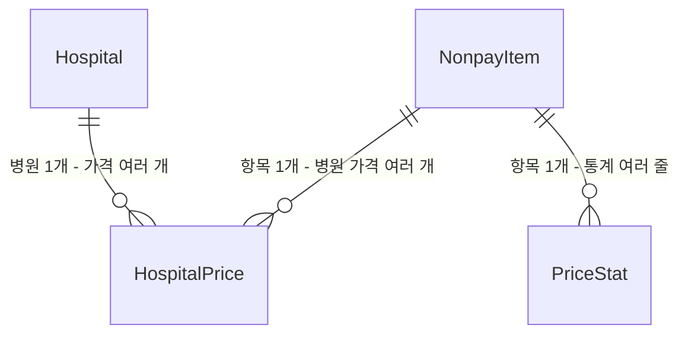

# 2026-11-17 데이터 모델 설계 (1주차 3일차)

브랜치: `feature/data-model`
작업 기간: 2026-11-14 ~ 2026-11-17 (API 활용신청부터 모델과 테스트까지)

## 무엇을 만들었나
| 파일 | 내용 |
|---|---|
| `backend/nonpay/models.py` | 모델 4개: `NonpayItem`(비급여 항목), `Hospital`(병원), `HospitalPrice`(병원별 가격), `PriceStat`(가격 통계) |
| `backend/nonpay/migrations/0001_initial.py` | 위 모델로 만든 첫 마이그레이션. 중복 금지 규칙 2개 포함 |
| `backend/nonpay/tests.py` | `HospitalPrice` 중복 금지 규칙 테스트 2개 |
| `docs/작업기록/api-guide.md` | 심평원 비급여진료비정보서비스 활용가이드 요약 |
| `.env.example` | 공공데이터포털 키 이름을 `DATA_GO_KR_API_KEY`로 통일 (`.env`와 같은 이름) |

## ERD

| 모델 | 뜻 | 데이터 출처 (API 기능) | 한 줄을 구분하는 기준 |
|---|---|---|---|
| `NonpayItem` | 비급여 항목 | ③ 코드조회 `getNonPaymentItemCodeList2` | `npay_cd` (PK) |
| `Hospital` | 병원 | ④ 요약 / ⑤ 상세 응답 | `ykiho` (PK) |
| `HospitalPrice` | 병원별 가격 | ⑤ 상세 `getNonPaymentItemHospDtlList` | (병원, `sno`, 적용개시일자) |
| `PriceStat` | 가격 통계 | ⑥ 종별 `getNonPaymentItemClcdList` + ⑦ 지역 `getNonPaymentItemSidoCdList` | (항목, 구분, 그룹 코드, 기준일) |

## 왜 이렇게 했나

### 실제 API 응답으로 확인한 것
가이드 문서(2019년)가 오래돼서 숫자와 필드는 미리보기와 확인 스크립트로 직접 확인했다.

| 확인한 것 | 결과 | 반영 |
|---|---|---|
| 한 번에 받을 수 있는 줄 수 | `numOfRows=1000`으로 943건이 한 번에 옴 (가이드의 "2자리 = 99"는 틀린 추정이었음) | 항목, 통계는 각각 호출 1번이면 끝 |
| ③ 항목 수, 코드 중복 | 943건, `npayCd` 중복 0 | `npay_cd`를 PK로 사용 |
| ⑥ ⑦ 통계 항목 수 | 714건 | 통계는 하루 호출 2번 |
| ⑤ 중앙대병원 가격 줄 수 | 732건 (1,000 미만) | 병원당 호출 1번. 큰 병원을 대비해 수집 코드에는 페이지 반복을 넣는다 |
| 통계에서 값이 없는 칸 | 0이 아니라 태그 자체가 빠져서 옴 | 0과 태그 없음 모두 NULL |
| 세종 접미사 | 가이드는 `Sejong`, 실제는 `Sj` | 실제 응답 기준으로 쓴다 |

### 결정 1. 병원별 가격은 ⑤ 상세의 `curAmt`로 저장한다 (B안)
- ④ 요약은 병원별로 최소~최대 범위(`minPrc`, `maxPrc`)를 준다. ⑤ 상세는 병원이 매긴 금액(`curAmt`)을 한 줄씩 준다.
- 중앙대병원 PFM 크라운(`UW608F310`)으로 확인한 결과: ⑤에 PFM(구치부) 600,000원, PFM(전치부) 650,000원 두 줄이 있었다. ④ 요약의 범위는 600,000~650,000원으로, ⑤ 두 줄의 최솟값과 최댓값과 정확히 같았다.
- 그래서 `curAmt`는 평균이 아니라 **병원의 실제 개별 가격**이다. 범위보다 정확하고 "DB 값을 그대로 보여 준다"는 규칙과도 맞는다.

### 결정 2. 통계에서 0은 NULL로 저장하고 "데이터에 없음"으로 답한다
- 통계 API에서 0은 "0원"이 아니라 "그 종별이나 지역에 데이터가 없음"을 뜻한다.
- 0을 그대로 저장하면, 나중에 코드를 읽는 사람이 "0이라는 값이 있는데 왜 화면에 안 보여 주지?"라고 헷갈린다. 그래서 뜻대로 NULL로 저장한다.
- 이 규칙은 **통계(`PriceStat`)에만** 적용한다. 병원 가격(`cur_amt`)의 0은 진짜 0원(무료)일 수 있어서 그대로 저장한다.

### 중복 금지 기준을 실제 데이터로 정했다
중앙대병원 732줄로 조합마다 겹치는 수를 셌다.

| 조합 | 겹친 수 | 판정 |
|---|---|---|
| (병원, 항목, 적용개시일자) | 120 | ❌ PFM 구치부와 전치부처럼 서로 다른 가격이 사라짐 |
| (병원, 항목, 병원이 붙인 이름, 적용개시일자) | 5 | ❌ |
| (병원, `sno`) | 0 | ✅ |

`HospitalPrice`의 기준은 (병원, `sno`, 적용개시일자)로 정했다. 적용개시일자를 함께 넣은 이유는, 가격이 바뀌어 같은 `sno`에 새 날짜가 오면 옛 가격을 덮어쓰지 않고 새 줄로 쌓기 위해서다.

`PriceStat`의 기준에는 구분(`kind`)을 꼭 넣었다. 그룹 코드 `All`(전체)이 종별 통계와 지역 통계에 모두 있어서, 구분이 없으면 둘 중 하나가 사라진다.

### 모델의 칸 타입
- **코드는 `CharField`**: `01`, `110000`은 계산할 숫자가 아니라 이름표다. 숫자로 저장하면 `01`이 `1`이 된다.
- **이름과 설명은 `TextField`**: 길이를 미리 알 수 없어서 글자 수 제한에 걸려 저장이 실패하지 않게 했다.
- **`url_addr`도 `TextField`**: `URLField`는 형식 검사를 해서, API가 조금 이상한 주소를 주면 원본을 그대로 저장할 수 없다.
- **`9999-12-31`(적용종료일자)은 그대로 저장**: 원본을 바꾸지 않는다. "현재 유효"인지는 보여 줄 때 판단한다.
- **FK는 `on_delete=PROTECT`**: 병원이나 항목을 지울 때 연결된 가격까지 조용히 지워지는 것(`CASCADE`)을 막는다.
- **중복 금지는 `Meta`의 `UniqueConstraint`**: 여러 칸의 조합 규칙이라 칸 하나에 붙이는 `unique=True`로는 안 된다. DB에 규칙을 걸어 두면 어디서 저장하든, 동시에 저장하든 DB가 막아 준다.

### 지금 넣지 않은 것
- 임베딩(pgvector) 칸: 검색 기능을 만들 때 `NonpayItem`에 추가한다.
- 질문/답변 기록 표: Q&A 화면을 만들 때 추가한다.
- 그룹 코드 이름표(`Sl` → 서울 → `110000`): DB 표가 아니라 수집 코드 안의 사전 하나로 만든다. 가이드에 없는 코드는 실제 `Hospital` 데이터(`clCd`/`clCdNm`, `sidoCd`/`sidoCdNm` 쌍)에서 확인해서 채운다.

## 막혔던 것과 배운 것
- **미리보기 화면에 가이드 예시 값이 미리 채워져 있었다** (`clCd 01`, `sgguCd 110007`, `searchWrd 인실`). 동작구 병원을 동대문구 조건으로 찾아서 0건이 나왔다. 미리보기 전에는 칸을 모두 비우고 시작한다.
- **`Meta`를 `Meat`로 쓰면 에러 없이 무시된다.** 반대로 `Meta` 안의 `verbose_name_`, `verbose_namd` 같은 오타는 에러가 난다.
- **`constraints = [...],`처럼 끝에 쉼표가 있으면 튜플이 된다.** 눈에 잘 안 띈다.
- **`verbose_name`과 `verbose_name_plural`은 따로다.** 복수형을 안 쓰면 관리자 화면에 "병원s"로 나온다.
- **환경변수 이름이 둘로 갈렸다** (`DATA_GO_KR_SERVICE_KEY` / `DATA_GO_KR_API_KEY`). `DATA_GO_KR_API_KEY`로 통일했다.
- **추정한 숫자를 확인된 숫자처럼 쓰지 않는다.** "99줄", "항목 700~1,000개", "병원 수천 곳"은 처음에 근거 없이 쓴 추정이었고, 실제 응답으로 다시 확인했다.
- 테스트 에러는 맨 아래 줄부터 읽는다. `got unexpected keyword arguments: 'yamd_nm', 'sido'` → 칸 이름 오타.

## 어떻게 확인했나
- 확인 스크립트(파이썬 기본 기능만 사용, 키는 출력하지 않음)를 사용자가 직접 실행해 위 표의 숫자를 얻음
- `manage.py check`: no issues
- `manage.py makemigrations nonpay`: `0001_initial.py`에 모델 4개, `uniq_hospital_price`, `uniq_price_stat` 규칙 확인
- `manage.py migrate nonpay`: PostgreSQL에 표 4개 생성
- `manage.py test nonpay`: 2개 통과
  - 같은 병원, 같은 항목이라도 `sno`가 다르면 두 줄 모두 저장된다
  - (병원, `sno`, 적용개시일자)가 같으면 `IntegrityError`로 거부된다

## 남은 것
- `docker-compose.yml` healthcheck의 `POSTGERES_DB` 오타 (→ `POSTGRES_DB`)
- `PriceStat` 중복 규칙 테스트: 통계 수집 코드를 쓸 때 같이
- ⑤에 ③ 목록에 없는 코드가 오면 어떻게 할지: 수집 코드에서 정한다

## 다음 (제안)
- Celery 태스크로 ③ 항목, ⑥ ⑦ 통계 수집 (API 호출은 mock으로 테스트)
